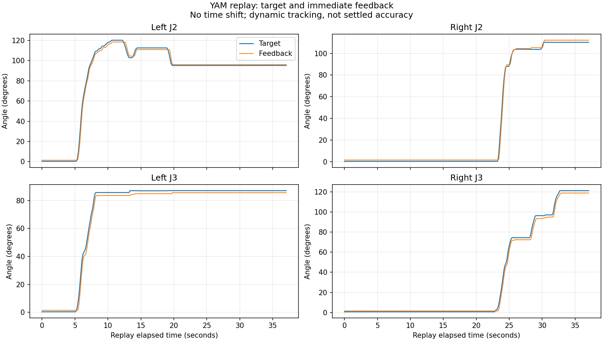

# 2026-11-25 YAM双臂实机验证

## 结论与范围

用户现场确认完整双臂抓放示教及轨迹回放成功，并在回放后按1保存。
最新数据发布为 `episode_00003.zarr`；原始manifest的complete、retained、alignable
及publication.complete均为true。验证的是手动示教、RGB/状态数采、原生读取和轨迹回放，
不代表学习策略、自主抓放、长期稳定性或末端精度已验收。

测试环境：旧主机i5-1135G7，Ubuntu 24.04，双D405共用480M USB2 Hub；
新主机与USB3连接尚未投入本轮测试。运行时限值为帧龄150ms、双相机时间差100ms。

## 记录证据

- 原始会话：`data/yam_bimanual_30hz/data/20261125-151215-11545b/`。
- 发布数据：`data/yam_bimanual_30hz/episode_00003.zarr/`。
- 采集日志：`logs/yam_capture/20261125-151215-11545b/`。
- 回放日志：`logs/replay/2026-11-25/151327_20261125-151215-11545b/`。
- 原始数据和设备日志不随Git仓库提交；本目录保留摘要、分析结果和图。

| 指标 | 结果 |
| --- | --- |
| 采集样本 | 1109行，时间跨度36.928726秒 |
| 实测采集频率 | 30.003743 Hz（1108个间隔） |
| 采集间隔P95 | 35.523898 ms |
| 状态、速度、动作 | 均为(1109,14)，全部有限；动作逐行等于示教实测qpos |
| 两路视频 | 各1157帧（含首尾阶段），录像队列丢帧计数均0 |
| 原生Episode读取 | 发布episode可打开；双路首/中/末帧均为(480,640,3) uint8 |
| 所选图像最大帧龄 | 左64.562 ms、右64.359 ms |
| 所选双路最大时间差 | 21.569 ms |
| 回放执行行 | 0至1108完整，无缺号；用户现场确认成功 |
| 回放日志跨度/实测频率 | 37.058875秒 / 29.898371 Hz |

这一次实际图像时序落在80/50ms以内，但启动配置仍为150/100ms，
不能据此推断恢复严格限值后能长期稳定，也没有修改本次原始限值来“补通过”。

原生Episode读取是训练数据接口的基础检查；只抽查三处图像解码，不等于完整训练
DataLoader、预处理配置和训练一步测试已通过。发布目录引用原始流，迁移需保留二者。

## 回放误差的计算口径

每个控制tick先发送该行目标，再立即读取关节反馈，记录target和qpos；误差为qpos-target。
统计覆盖全部1109行，没有删掉峰值、时间平移、重采样或角度取模。
反馈包含运动滞后与SDK状态读取时序，所以这些数值是动态同tick跟踪差异，
不是到位后静态误差、零点偏移或末端位置误差。日志time是wall-clock，频率仅为该段日志测量。

J1–J6单位为度；gripper单位为归一化开度的百分点（不是度，也不是相对于目标的百分比）。

| 侧别/关节 | 平均绝对误差 | RMSE | 绝对误差P95 | 最大绝对误差 | 峰值原始行 |
| --- | ---: | ---: | ---: | ---: | ---: |
| 左 J1 | 0.360 | 0.965 | 1.840 | 6.426 | 592 |
| 左 J2 | 1.538 | 1.938 | 3.838 | 8.240 | 174 |
| 左 J3 | 1.873 | 2.144 | 4.437 | 7.366 | 173 |
| 左 J4 | 1.131 | 1.267 | 2.138 | 4.175 | 215 |
| 左 J5 | 0.667 | 0.962 | 2.072 | 5.115 | 574 |
| 左 J6 | 0.781 | 1.334 | 2.527 | 9.245 | 122 |
| 左 gripper | 0.280 | 0.572 | 1.263 | 3.905 | 536 |
| 右 J1 | 0.550 | 1.016 | 1.290 | 7.169 | 959 |
| 右 J2 | 1.500 | 1.837 | 2.076 | 8.896 | 716 |
| 右 J3 | 1.704 | 2.188 | 5.110 | 6.776 | 741 |
| 右 J4 | 1.485 | 1.659 | 2.605 | 6.470 | 741 |
| 右 J5 | 0.862 | 1.306 | 2.129 | 9.398 | 870 |
| 右 J6 | 0.743 | 0.938 | 1.902 | 5.989 | 669 |
| 右 gripper | 0.181 | 0.515 | 0.729 | 3.582 | 788 |



左右J2/J3的平均绝对误差接近：左J2/J3为1.538°/1.873°，右为1.500°/1.704°。
右J3的P95为5.110°，左为4.437°；右J2最大8.896°，左为8.240°。
全关节最大瞬时误差发生在右J5，9.398°。这些结果不支持“右J2/J3电机肯定异常”
或“右臂零位再次漂移”的定论；也不足以宣布动态精度合格。
后续应按实际任务容差评估，再定位速度变化、延迟、负载和跟踪增益的贡献。
本次分析未改零位、重力参数、驱动或运动控制。

## 本轮解决的问题

1. 两路软件编码原先自动开较多线程，出现视频写入落后和丢帧。
   采用ultrafast、单编码/颜色转换线程与zerolatency，保留5Mbps及原始分辨率。
2. 状态逐行扩容写入二十多个Zarr数组，形成持续积压。
   合并已排队的少量样本写入，每个样本仍校验原始状态/帧引用，正常每轮最多8条。
3. 协调进程原先连续处理128条可能耽误状态轮询。
   缩短正常批次；没有扩大队列、关闭缺帧校验或提高心跳超时。

软件改进后的相机独立会话 `20261125-150245-731056`：60秒1800条、29.999957Hz，
两路各1850帧全解码通过、录像丢帧0、manifest完整且可对齐。
该对照最大所选帧龄约114ms，说明旧电脑仍会出现超80ms的波动。

## 复现分析

从仓库根目录运行：

```bash
../i2rt/.venv/bin/python scripts/analyze_yam_replay.py \
  logs/replay/2026-11-25/151327_20261125-151215-11545b/steps_000.npz \
  --output docs/validation/2026-11-25-replay-metrics.json

# 可选绘图依赖；不属于采集必需依赖
uv pip install --python ../i2rt/.venv/bin/python -r scripts/requirements-yam-analysis.txt
../i2rt/.venv/bin/python scripts/analyze_yam_replay.py \
  logs/replay/2026-11-25/151327_20261125-151215-11545b/steps_000.npz \
  --plot docs/validation/2026-11-25-j2-j3.png
```

机器可读统计：[replay-metrics.json](2026-11-25-replay-metrics.json)。
原始NPZ SHA-256：`c550a3bc78329af75a4beedac413405bff12218a1296de8a6a6efd8c8bbf8d4e`。

## 尚未完成

- 右臂大幅前伸的自由重力补偿范围与任务精度验收。
- 新机/USB3实际映射、80/50ms时序及多轮完整负载稳定性。
- 正式训练数据加载、模型训练和自主策略部署。
- 本次review后的修改合入、新电脑实机复现与更严格验收。
  软件已另完成[独立目录/环境复现验证](2026-11-25-reproduction.md)。
