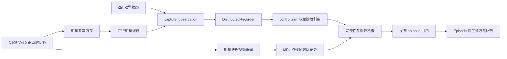

# YAM数采适配：Review说明

## 目的和当前范围

把Flash ALOHA的手动示教、录制及轨迹回放流程接到i2rt YAM Ultra 2双臂。
已验证双D405 RGB 640×480@30、14维状态/动作、手动夹爪示教和完整任务回放。
保留上游ARX能力；不宣称上游训练配置或策略部署已适配YAM。

本次代码、教程和实机摘要提交用于review；新主机/USB3、长期稳定性和任务精度仍待验收。
使用方式见[README](../README.md)和[完整YAM教程](yam_quickstart.md)，
结果见[实机报告](validation/2026-11-25-yam.md)。

## 阅读顺序与改动边界

| 文件 | Review内容 |
| --- | --- |
| `scripts/setup_yam.sh`、`scripts/check_yam.sh` | 固定SDK提交、退出补丁、完整Python依赖及无硬件检查 |
| `scripts/08_*`、`scripts/10_*`、`scripts/13_*` | 原重力补偿测试迁入；Python控制逻辑不变，启动器适配仓库路径 |
| `scripts/tune_yam_gripper.py`、`src/hardware/yam_gripper_friction.py` | 可选夹爪速度摩擦助力，单臂调参；实机参数尚待验证 |
| `scripts/collect_yam.sh` | 仓库内启动器、Python/SDK位置和显式时序配置 |
| `scripts/record_yam.py` | 相机启动、标准观测、录制/保存/回放状态流程，默认手动夹爪 |
| `src/hardware/backends/yam.py` | SDK适配、同一状态对象读取qpos/qvel、夹爪归一化、命令看门狗、回放与退出 |
| `src/hardware/arm_factory.py` | YAM模型及后端的惰性构造 |
| `src/recording/practice_support.py` | 不依赖训练栈的上下文、键盘监听和标准观测适配 |
| `scripts/practice.py`、`src/recording/replay_practice.py` | 既有无相机示教入口增加YAM分支 |
| `src/camera_utils/camera_server.py` | D405协商的YUYV及行padding解码、驱动坏帧拒绝、设备覆盖、libx264低CPU设置 |
| `src/camera_utils/robotmq_camera_cache.py` | 超时异常增加所选帧各阶段耗时诊断，不重选帧 |
| `src/recording/distributed_recording.py` | 已排队状态按小批量写盘、提交计数/边界；发布时保留YAM型号元数据 |
| `scripts/apply_yam_robologger_patch.py`、`scripts/patches/` | 给锁定的robologger 0.1.7增加编码配置字段；重复运行不重复应用 |
| `calibration/d405_640x480_30.npz` | 当前模式示例，不是手眼/外参标定 |
| `scripts/analyze_yam_replay.py` | 只读单段日志统计，无时间平移；关节度、夹爪百分点 |

核心数据路径：



## 本轮保持的契约

- 每条观测仍从 `capture_observation` 产生，录制使用它的原始 `recording_fields()`。
- 每臂qpos/qvel来自一次SDK状态快照；状态/动作顺序为左六关节+夹爪、右六关节+夹爪。
- 手动示教动作标签为同一行实测qpos，绝对坐标；不是电机力矩指令。
- 图像按已选帧号及驱动时间戳引用；不在发布时另选最近帧，不造时间戳，不补缺帧。
- 缺帧/过期/偏斜与异常时钟继续失败退出，自动GC暂停仍由共享capture_gc管理。
- 状态队列正常每轮最多取8条已排队样本，不等待凑批；写入成功后更新count。
  暂停/停止仍等待生产者声明的expected_sample_count。队列容量和心跳超时没有放大。

## 特别需要关注的实现限制

1. YAM SDK快照路径访问 `_state_lock`/`_joint_state`，需关注SDK升级兼容性；
   已验证安装版本i2rt 1.1.2，其他版本不能未经验证直接等同。
2. 相机通过YAM_CAMERA_LEFT/RIGHT覆盖，CAN左右名由现场规则建立；迁移需人工确认身份。
3. libx264低CPU选项作用于共享相机服务器的libx264路径；NVENC路径不采用这组选项。
   依赖需应用仓库补丁，重装robologger后需重施。ultrafast同码率画质尚未验收。
4. 临时150/100ms限值通过环境变量明确传入并写入元数据；默认仍80/50ms。
   一次任务实测小于80ms，不等于严格限值下多轮稳定性已通过。
5. `r`准备回放会主动移到首帧；保存后返回启动姿态。无碰撞规划，需操作员清场和托稳。
6. 右臂大幅前伸自由重力补偿仍有不足。回放日志误差含运动滞后，不能当零位诊断。

7. 可选夹爪助力尚未实机验证，默认关闭。只在手动模式写J7前馈，有独立限幅；
   SDK的位置模式5N限力不约束这项前馈。使用固定SDK私有命令锁，见[助力说明](yam_gripper_friction.md)。

## 验证

初版核心无硬件测试76项通过；补齐复现后，独立环境85项及4个subtests通过，含重力诊断和退出测试。
新增夹爪助力后，固定环境112项及4个subtests通过；历史抓放实机证据均来自无助力配置。
固定SDK、依赖安装、模型FK和FFmpeg检查见[安装指南](yam_quickstart.md)。
[独立目录复现记录](validation/2026-11-25-reproduction.md)说明实际运行范围及硬件验收边界。

实机证据：双相机60秒1800条通过，随后双臂任务1109条录制/保存/回放通过；
原生发布Episode的状态、动作和首中末图像读取通过。测试不等于完整训练链路验收。

从仓库根目录运行：

```bash
bash scripts/setup_yam.sh  # 首次安装，不操作设备
bash scripts/check_yam.sh  # 依赖、SDK/编码补丁、模型及核心模拟测试
```

这些测试使用模拟状态/硬件，不启动机械臂或真实相机。真实数采/回放由操作员按教程执行。
上游完整测试含训练依赖，不应把轻量环境的核心测试通过称为整个项目全套测试通过。
